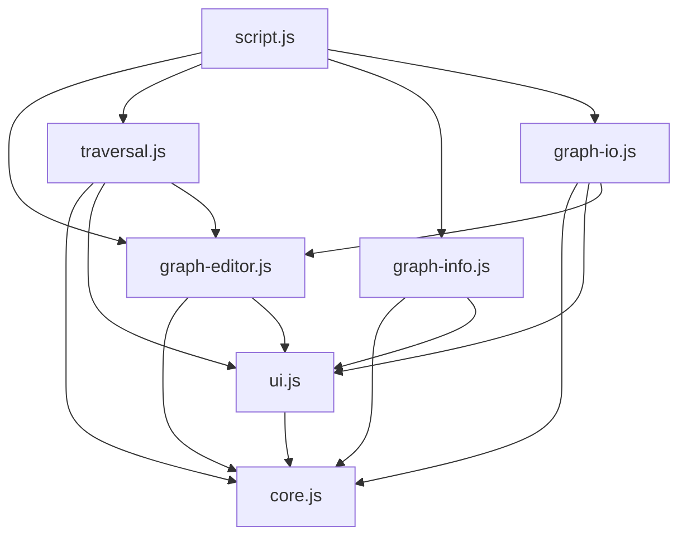
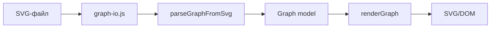

# Архитектура графового редактора

Код разделён по принципу **functional core / imperative shell**.

- **Functional core** (`core.js`) — чистые функции без DOM, таймеров и побочных эффектов.
- **Imperative shell** — модули, которые связывают ядро с DOM, событиями, анимацией и файловой системой.

## Модули

| Модуль | Роль |
| --- | --- |
| `core.js` | Модель графа, вершины и рёбра, матрица и список смежности, обходы BFS/DFS, генерация шагов визуализации. |
| `ui.js` | Общие DOM-ссылки, состояние приложения, SVG-хелперы, цвета, блокировка контролов. |
| `graph-editor.js` | Создание SVG-элементов, добавление вершин и рёбер, перетаскивание, отрисовка и очистка графа. |
| `traversal.js` | Запуск BFS/DFS, воспроизведение шагов обхода с задержками, вывод результата. |
| `graph-info.js` | Модальное окно с матрицей и списком смежности. |
| `graph-io.js` | Экспорт SVG в файл и импорт графа из SVG-файла. |
| `script.js` | Только импортирует оболочки, чтобы инициализировать их обработчики. |

## Зависимости



`core.js` не зависит ни от одного другого модуля. Все остальные модули являются оболочками.

## Модель данных

```js
Graph = {
    vertices: [{ id, x, y }],
    edges: [{ id, fromId, toId }]
}
```

Граф обновляется иммутабельно: операции `addVertex`, `addEdge`, `moveVertex` возвращают новый объект. DOM-элементы хранятся отдельно в `state.vertexElements` и `state.edgeElements`.

## Поток выполнения

```text
Пользовательское событие
        |
        v
Оболочка (editor / traversal / info / io)
        |
        +--> читает state.graph
        |
        +--> вызывает чистую функцию core.js
        |
        +--> применяет результат к DOM / таймерам / файлу
```

### BFS и DFS

Чистые функции `bfsTraversal` и `dfsTraversal` не меняют DOM. Они возвращают:

```js
{
    visited: ["1", "2", "3"],
    steps: [
        { type: "vertex", vertexId: "1" },
        { type: "edge", edgeId: "100001" },
        { type: "vertex", vertexId: "2" }
    ]
}
```

`traversal.js` превращает этот список шагов в последовательность `setTimeout`-вызовов. Поэтому алгоритм легко тестировать отдельно от интерфейса.

### Импорт и экспорт



Экспорт работает в обратном направлении: текущий SVG сериализуется и скачивается как файл.

## Правила расширения

1. Новую логику графа добавлять в `core.js` в виде чистых функций.
2. DOM, события, таймеры и файловые операции оставлять в оболочках.
3. Общие DOM-ссылки и состояние хранить в `ui.js`.
4. `script.js` не должен содержать логику — только импорты оболочек.

## Подключение

`script.js` использует ES-модули, поэтому подключается так:

```html
<script type="module" src="scripts/script.js"></script>
```
