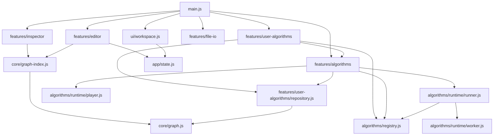
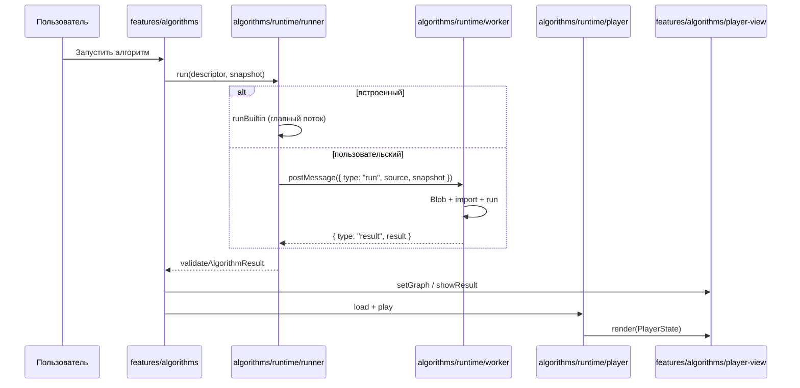

# Архитектура графового редактора

Код разделён по принципу **functional core / imperative shell**.

- **Functional core** — чистые функции без DOM, таймеров и побочных эффектов: `core/graph.js`, `core/graph-index.js`, `algorithms/contract.js`, `algorithms/runtime/player.js`, `features/user-algorithms/repository.js`.
- **Imperative shell** — модули, которые связывают ядро с DOM, событиями, воркерами и файловой системой.

Точка входа — `main.js`. Она явно инициализирует фичи в нужном порядке:

```js
initEditor();
initAlgorithmPanel();
initUserAlgorithms();
initInspector();
initFileIO();
initWorkspace();
```

## Слои

| Слой | Модули | Роль |
| --- | --- | --- |
| Core | `core/graph.js` | Модель графа: вершины, рёбра, поиск, удаление, переименование, генерация id. |
| Core | `core/graph-index.js` | Производный read-only индекс: `Map` вершин и рёбер, соседи, инцидентные/исходящие/входящие рёбра, ленивые матрицы. Кэш по `WeakMap`. |
| Algorithms | `algorithms/contract.js` | Версия контракта, фабрики шагов, хелперы, `validateAlgorithmResult`, лимиты, `AlgorithmContractError`, `toAlgorithmRunError`. |
| Algorithms | `algorithms/registry.js` | Реестр дескрипторов: `register`, `get`, `list`, `remove`, `subscribe`; нормализация `meta` и `run`/`code`. |
| Algorithms | `algorithms/builtins/` | Встроенные BFS, DFS и гамильтонов путь: `meta`, псевдокод и `run`. Регистрируются в `builtins/index.js`. |
| Algorithms | `algorithms/runtime/runner.js` | Запуск: встроенный алгоритм — в главном потоке, пользовательский — в Worker. Таймаут (10000 мс), отмена, проверка результата. |
| Algorithms | `algorithms/runtime/worker.js` | Точка входа Worker: `Blob` + динамический `import`, вызов `run`, сериализация результата и ошибок. |
| Algorithms | `algorithms/runtime/player.js` | Плеер как состояние: шаги, индекс, play/pause, шаг вперёд/назад, скорость, сброс. Планировщик и рендер внедряются снаружи. |
| App | `app/constants.js` | Режимы, цвета, размеры, SVG namespace. |
| App | `app/dom.js` | Общие DOM-ссылки и `createSvgElement`. |
| App | `app/events.js` | Простая подписка/эмиссия событий. |
| App | `app/state.js` | Мутируемое состояние оболочки, события графа и доступности алгоритмов, проекции статистики. |
| App | `app/utils.js` | `clamp`, `pluralize`, `formatError`. |
| UI | `ui/canvas.js` | Координаты холста, цвета вершин и рёбер, выделение. |
| UI | `ui/workspace.js` | Панели, вкладки, режим фокуса, ресайз, HUD и скорость воспроизведения. |
| Features | `features/editor/` | SVG-элементы вершин и рёбер, viewport, контекстное меню, создание/перетаскивание/удаление. |
| Features | `features/algorithms/` | Список алгоритмов, плеер-представление и контроллер запуска. |
| Features | `features/inspector/` | Матрица смежности, матрица инцидентности и список смежности, копирование в формате Python. |
| Features | `features/file-io/` | Экспорт SVG, JSON и Graphviz DOT, импорт SVG, JSON и Graphviz DOT. |
| Features | `features/user-algorithms/` | Хранение, список и редактор пользовательских алгоритмов. |

## Зависимости



`core/*`, `algorithms/contract.js`, `algorithms/runtime/player.js` и `features/user-algorithms/repository.js` не зависят от DOM. DOM-модули получают состояние и ссылки из `app/` и `ui/`.

## Модель данных

```js
Graph = {
    vertices: [{ id, x, y, label }],
    edges: [{ id, fromId, toId, weight }],
    directed: false,
}
```

Граф обновляется иммутабельно: операции `addVertex`, `addEdge`, `moveVertex`, `removeVertex` возвращают новый объект. `weight` и `directed` зарезервированы для будущих алгоритмов, UI их пока не редактирует. DOM-элементы хранятся отдельно в `state.vertexElements` и `state.edgeElements`.

`GraphIndex` строится один раз на объект графа и кэшируется:

```js
GraphIndex = {
    graph, directed, vertexIds,
    vertexById, edgeById,
    adjacency, incident, outgoing, incoming, edgeByPair,
}
```

`adjacency` — соседи, отсортированные `compareVertexIds`; для неориентированного графа это объединение `outgoing` и `incoming`.

## Алгоритмы

Контракт описан в [`algorithms/README.md`](algorithms/README.md). Коротко:

- алгоритм — обычный ES-модуль с функцией `run(context)`;
- контекст: `{ graph: GraphIndex, startVertexId, params, helpers }`;
- результат: `{ steps, visited?, resultText?, stats? }`;
- шаги: `vertex` / `edge` / `log` с опциональными `line` и `tone`;
- встроенные алгоритмы исполняются в главном потоке, пользовательские — в Worker с таймаутом 10000 мс;
- добавление встроенного алгоритма = один файл в `algorithms/builtins/` плюс регистрация в `algorithms/builtins/index.js`.

### Пользовательские алгоритмы

- Хранятся в `localStorage["graph-studio.user-algorithms"]`: `{ version, algorithms: UserAlgorithmRecord[] }`.
- `id` нормализуется в `user:<slug>`; суммарный размер исходников — не больше 256 КБ.
- `source` — текст ES-модуля (`export function run`, `export default function run` или `export default { run }`).
- Битые записи при старте не регистрируются, а показываются в списке как «Ошибка».
- Перед первым запуском/проверкой/сохранением кода запрашивается подтверждение; согласие живёт в `sessionStorage`.
- Worker не имеет DOM, но работает в том же origin, поэтому запускать можно только доверенный код.

## Поток выполнения



Плеер ничего не знает о конкретном алгоритме: он получает готовые `steps`, `pseudocode` и `resultText`.

## Тесты

`npm test` запускает `node --test`. Тесты лежат в `../tests/` и импортируют только чистые модули: `core/`, `algorithms/`, `algorithms/runtime/` и `features/user-algorithms/repository.js`.
